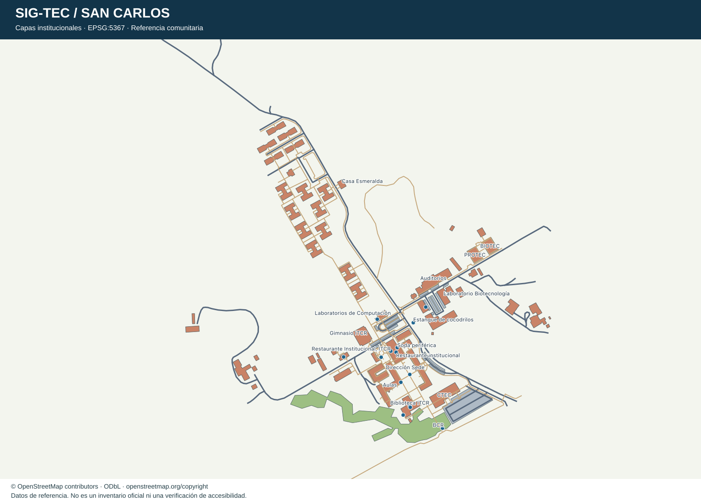
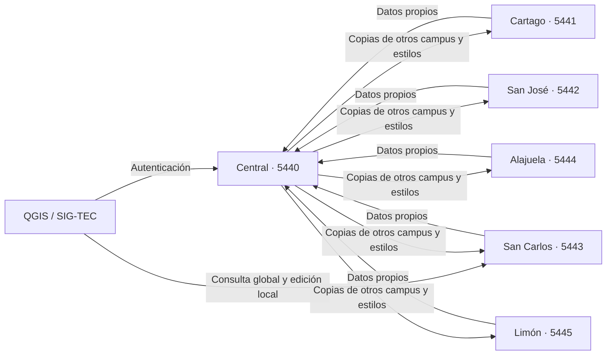

# SIG-TEC · QGIS e integración distribuida

**Entrega individual de Kay · v1.0.0 · Campus inicial: San Carlos**

Complemento de QGIS para autenticar usuarios contra un nodo central, conectarlos
al campus autorizado y administrar ocho capas geográficas institucionales.
Integra los seis nodos PostgreSQL/PostGIS del repositorio de Andrés.

**Para Brady:** comenzar por el [contrato v1](docs/CONTRATO_BRADY.md) y la
[guía de continuidad](docs/CONTINUIDAD_BRADY.md). La interfaz ya está implementada;
puede continuar con 2PC manteniendo ese contrato.



## Qué incluye

- Inicio de sesión real contra PostgreSQL central y selección automática del nodo.
- Ocho vistas globales: edificios, carreteras, aceras, parqueos, zonas verdes,
  puntos de interés, iluminación y accesibilidad.
- Edición del campus propio y consulta de los cinco campus, en EPSG:5367.
- Formularios, etiquetas y ocho estilos compartidos mediante `layer_styles`.
- Preparación repetible, validación del contrato y respaldos con roles.
- 358 objetos de referencia de OpenStreetMap, con fuente y procedencia registradas.
- Fuentes de la infraestructura original de Andrés con commit y hashes identificados.

La [entrega individual de Kay](docs/ENTREGA_KAY.md) cubre software, integración y
 documentación. El video se pospone expresamente; 2PC y la aceptación integral
 del proyecto grupal se incorporan después.

## Inicio rápido

Requisitos: Docker Desktop abierto, QGIS LTR 3.44 con PyQGIS y psycopg2, Python 3
y Bash 4 o posterior para los scripts originales de infraestructura.
Se verificó QGIS 3.44.15 en Mac Apple Silicon. En Windows se usa Git Bash y el
entorno Python de QGIS; su instalación debe verificarse en ese sistema.

```sh
git clone --branch kay/qgis-v1 https://github.com/AndresZum04/sigtec-infraestructura.git
cd sigtec-infraestructura
bash sigtec.sh preparar
```

La infraestructura ya está incluida; no hace falta clonar otro repositorio.
`preparar` inicia los nodos, configura la replicación y los permisos, conserva
estilos existentes, importa sin duplicar datos y copia el complemento al perfil
local. Genera cuentas de demostración en `.local/acceso_qgis.txt`.

En Mac se detecta QGIS LTR automáticamente. Para otra ubicación:

```sh
bash sigtec.sh preparar --qgis-python /ruta/al/python-de-QGIS
```

Si se desea preparar las bases sin copiar el complemento al perfil:

```sh
bash sigtec.sh preparar --sin-instalar
```

El ZIP del complemento se puede instalar desde **Complementos → Administrar e
instalar complementos → Instalar a partir de ZIP**, seleccionando
`dist/SIGTEC_QGIS.zip`. Activar **SIG-TEC** después de instalarlo.

## Trabajar en QGIS

1. Abrir QGIS con un proyecto nuevo.
2. Abrir **Complementos → SIG-TEC → SIG-TEC · Ingresar** o su icono en la barra.
3. Ingresar como `kay`, usando la contraseña local generada.
4. El central identifica el campus 3 y el complemento carga las ocho vistas.
5. Seleccionar una capa, activar la edición y guardar sus cambios en PostgreSQL.

El formulario protege id, campus, fechas y áreas automáticas. Edificios y puntos
 de interés requieren nombre. Un objeto ajeno puede consultarse, pero la base
 rechaza su modificación o eliminación. El filtro «solo mi campus» es de
 visualización y no sustituye los permisos.

Guardar el proyecto `.qgs` o `.qgz` conserva la configuración del mapa; guardar las
**ediciones de la capa** escribe los cambios en la base. El complemento protege
ediciones pendientes al recargar o cerrar sesión y conserva capas independientes.
Las contraseñas no se guardan en el proyecto ni en la configuración del plugin.

El proyecto preparado está en `qgis/SIGTEC_San_Carlos.qgs`. Para abrirlo sin una
solicitud adicional de credenciales, ingresar primero con el complemento.
El fondo OpenStreetMap es opcional y requiere Internet; los datos de la base
pueden consultarse sin ese fondo.

## Operación y pruebas

| Comando | Resultado |
|---|---|
| `bash sigtec.sh preparar` | Preparación completa y repetible |
| `bash sigtec.sh iniciar` | Iniciar los nodos y comprobar la integración |
| `bash sigtec.sh estado` | Inspeccionar nodos, vistas, estilos y conteos |
| `bash sigtec.sh contrato` | Validar el contrato v1 en las seis bases |
| `bash sigtec.sh verificar` | Validar contrato y ejecutar pruebas funcionales reales |
| `bash sigtec.sh respaldar central` | Respaldo lógico, físico y de roles del central |
| `bash sigtec.sh respaldar sancarlos` | Respaldo equivalente del nodo de San Carlos |
| `bash sigtec.sh detener` | Detener conservando los datos |

Los nombres de nodo son `central`, `cartago`, `sanjose`, `sancarlos`, `alajuela` y
`limon`. Los respaldos permanecen fuera del repositorio.

Para comprobar fuentes y construir instalables sin QGIS ni bases activas:

```sh
python3 -m unittest discover -s pruebas -p test_fuentes.py -v
python3 scripts/instalar_complemento.py --solo-zip
python3 scripts/empaquetar_entrega.py
python3 pruebas/test_paquete_integrado.py
```

El último comando requiere Docker Compose para inspeccionar las rutas; no inicia
contenedores. GitHub Actions ejecuta estas comprobaciones y publica los paquetes
como artefactos de cada ejecución. Las pruebas funcionales de las seis bases se
ejecutan localmente con `verificar`; no se presentan como pruebas ejecutadas en CI.

## Arquitectura



QGIS usa los puertos del host. La replicación interna usa nombres de servicio y
puerto 5432. El nodo central de autenticación es distinto del campus de Cartago.

## Documentación

| Documento | Contenido |
|---|---|
| [Entrega individual](docs/ENTREGA_KAY.md) | Alcance cerrado de esta versión y límites |
| [Contrato v1 para Brady](docs/CONTRATO_BRADY.md) | Autenticación, columnas, operaciones, errores y estilos |
| [Contrato JSON](integracion/contrato_v1.json) | Interfaz verificable por código |
| [Continuidad para Brady](docs/CONTINUIDAD_BRADY.md) | Pasos concretos para continuar sin rehacer QGIS |
| [Integración con Andrés](docs/INTEGRACION_ANDRES.md) | Infraestructura, preparación y respaldos |
| [Verificación](docs/VERIFICACION.md) | Evidencias reales y límites de las pruebas |
| [Datos y procedencia](datos/README.md) | Clasificación, atribución y límites del inventario |
| [Sección del informe](docs/SECCION_DOCUMENTO_KAY.md) | Texto técnico listo para integrar al documento grupal |
| [Guion de demostración](docs/GUION_DEMOSTRACION.md) | Preparado; el video aún no se graba |
| [Contribución](CONTRIBUTING.md) | Reglas de desarrollo e integración |
| [Avisos de terceros](THIRD_PARTY_NOTICES.md) | Autoría y fuentes |

## Datos y límites de la entrega

La referencia OSM contiene 61 edificios, 29 carreteras, 231 recorridos peatonales,
22 parqueos, una zona verde y 14 puntos de interés. Iluminación y accesibilidad
están vacías y editables; sus operaciones se prueban con objetos temporales.
No se inventan atributos desconocidos ni se declara un inventario oficial.

Las cuentas se generan para cada instalación. La contraseña administrativa
`sigtec2026` pertenece al entorno local de desarrollo del repositorio original;
no es una cuenta institucional. `.local/`, WAL y respaldos no se publican.

La compatibilidad del contrato y la integración funcional están probadas. Las
pruebas no acreditan un despliegue institucional, 2PC ni una nueva recuperación
integral por PITR de la versión final del grupo.

## Distribución

Los scripts generan en `dist/` el complemento `SIGTEC_QGIS.zip`, la entrega
individual `SIGTEC_proyecto.zip` y `SHA256SUMS.txt`. El paquete conjunto incorpora
los fuentes de Andrés; los accesos y datos de ejecución quedan excluidos.

La infraestructura original se conserva en `docker-compose.yml`, `init/` y los scripts originales; su procedencia
está en `docs/infraestructura_origen.json`. La implementación de Kay se elaboró
con asistencia de Codex y conserva las referencias bibliográficas y de datos.
